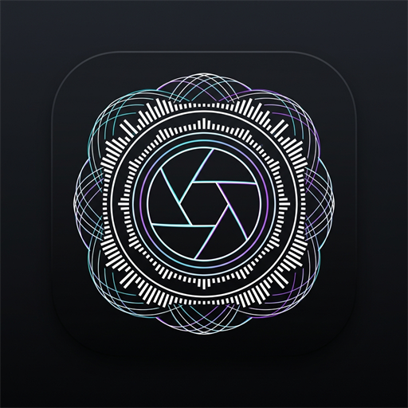

# Iris // High-Contrast Audio Visualizer

<p align="center">
  
</p>

<p align="center">
  <b>A minimalist, ultra-high-contrast studio audio visualizer for Windows.</b><br>
  Zero virtual cables. Native desktop audio loopback. Pure black & white precision meters with custom tinting.
</p>

<p align="center">
  
  
  
  
</p>

---

## ⚡ Overview

**Iris** captures all sound playing through your PC (Spotify, YouTube, games, DAWs) directly through native **Windows WASAPI Loopback** at 60 FPS with zero perceived latency.

Designed with a strict brutalist studio aesthetic: pure black, razor-sharp high-contrast lines, subtle dot-matrix texture, and an edge-to-edge layout where headers and resize controls stay invisible until you hover your mouse.

---

## 🎛️ 7 Precision Metering Modules

* **01 // Spectrum RTA**: 20 Hz – 20 kHz log analysis with +3.5 dB/oct slope compensation. Toggle between Smooth Catmull-Rom Curve and high-density LED Bars. Includes real-time musical pitch note detection (e.g., `A2 • 110.0 Hz`).
* **02 // Oscilloscope**: Zero-crossing edge trigger synchronization for locked waveforms. Selectable timebases (2 ms to 20 ms).
* **03 // Spectrogram**: Smooth 2D waterfall frequency distribution over time.
* **04 // Stereometer**: Lissajous stereo field & phase correlation meter (-1.0 to +1.0) with dynamic boost and Rhombus / Circle boundary modes.
* **05 // Analog VU**: Mechanical ballistics needles (300 ms damping) with calibrated dBFS reference.
* **06 // Waveform**: Live raw PCM time-history buffer displaying dynamic envelope.
* **07 // Loudness**: Broadcast standard EBU R128 LUFS metering (Momentary, Short-Term, and Integrated) with True Peak readout.

---

## 🚀 Download & Installation

### Option 1: Portable Executable (Recommended)
No installation or runtime required. Just download and run:
1. Go to the [Releases](https://github.com/) tab on the right side of this repository.
2. Download `Iris 1.0.0.exe`.
3. Double-click to launch anywhere on your Windows PC.

*(On first launch, Windows SmartScreen may display an alert because it is an independent unsigned app. Click "More info" → "Run anyway".)*

### Option 2: Run from Source
Requires [Node.js](https://nodejs.org/) (v18+ recommended):

```bash
# Clone the repository
git clone https://github.com/acidatonic/iris-audio-visualizer.git
cd Iris

# Install dependencies
npm install

# Start the application
npm start
```

---

## ⌨️ Controls & Shortcuts

| Action | Control |
| :--- | :--- |
| **Move Window** | Drag anywhere on the top bar |
| **Resize Modules** | Hover any module and drag the bottom-right corner or edges |
| **Show Controls** | Hover mouse over any meter card to reveal options and header |
| **Solo Meter** | Click `SOLO` on any meter to maximize it across the screen |
| **Pin Window** | Click the pin icon in the top right to keep Iris **Always On Top** |
| **Background Mode** | Toggle between transparent desktop overlay (**GLASS**) and pure pitch black (**SOLID**) |
| **Color Tint** | Click **TINT** to pick custom neon/accent colors |

---

## 🛠️ Building the Standalone Executable

To package your own portable binary:

```bash
npm run dist:portable
```

The output will be generated inside the `dist/` directory as `Iris 1.0.0.exe`.

---

## 📄 License

This project is licensed under the [MIT License](LICENSE).
